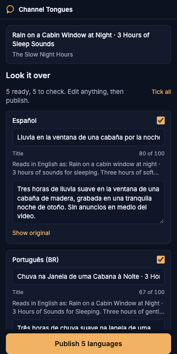

# Channel Tongues

Your channel's titles and descriptions in every language, translated on your own laptop.



YouTube already shows viewers abroad a machine translation of your titles, and you never get to read it. Channel Tongues opens next to YouTube Studio as a Chrome side panel; you press Translate, and Gemma 4 running on your computer through Ollama writes the title and description in the twelve languages with the biggest YouTube audiences. You read them over, press Publish, and the helper adds them to the video through the official YouTube Data API after taking a backup.

## Install

You need a Mac or Linux machine with Chrome, Go 1.26 and Node 26.

1. Install Ollama from [ollama.com/download](https://ollama.com/download) and open it.
2. Get the code and build it:
   ```
   git clone https://github.com/nazboyko/channel-tongues && cd channel-tongues && make build
   ```
3. Run the setup. It downloads the model, walks you through your own Google project if you want Channel Tongues to publish for you, shows how to load the extension, and lets Chrome start the helper for you:
   ```
   bin/tongues setup
   ```
4. Open a video in YouTube Studio and click the Channel Tongues icon. The panel starts the helper by itself. (Without step 3's Chrome connection, run `bin/tongues serve` first.)

Translating works without any Google sign-in: choose "I'll paste it myself" in the panel (on a Studio video page it fills in the title and description for you), then copy the results or save them to a folder.

## How it works

```
Chrome, Studio tab
  └─ side panel ──HTTP 127.0.0.1:7312, pairing code──> tongues helper (Go, on your machine)
                                                          ├── Ollama + Gemma 4     translates on your machine
                                                          ├── YouTube Data API     your own Google project and sign-in
                                                          └── data folder          sign-in file, backups, history
```

For each language the helper does five things:

1. **Protect.** Links, timestamps, hashtags, @handles, e-mail addresses and your keep words become placeholders such as `⟦1⟧`, so the model cannot change them.
2. **Translate.** One call per language to the local model, with the description sent as a list of lines and a JSON schema that fixes the line count. Lines you wrapped in the middle of a sentence are joined first, so the model translates the sentence whole; paragraphs, timestamps, links, hashtags, list items and short lines keep their own lines.
3. **Check.** Every placeholder present once and on its own line, blank lines where the original has them, the title at most 100 characters, the description within YouTube's limit, no `<` or `>`, no link or hashtag the original does not have, the right script for the language, no Latin word added to a translation in another script, and a one-word language check for Latin-script languages. A failed check retries twice with the exact problem; after that the language is marked **Check this one** with the reason, and it is never published unless you tick it yourself.
4. **Read it back.** The same model translates the new title and the first line of the description back into the video's language. The panel shows it under each title ("Reads in English as: ..."), so you can check the meaning of a language you cannot read. Words in the read-back that the original does not have are marked; a word added to the title makes the language Check this one with the reason, for example "adds: mountain".
5. **Restore.** The placeholders go back to the original text, byte for byte.

Publishing reads the video first and merges: languages the video lacks are added, translations Channel Tongues wrote earlier are updated, and anything else already on the video is kept unless you ask to replace it. The helper sends the complete set of translations (YouTube deletes any language left out), never the title, description or tags, then reads the video back to confirm. Undo puts the backup back the same way.

## What you give and to whom

| | Without signing in | Signed in to publish |
|---|---|---|
| Your Google account | Nothing | A sign-in to **your own** Google Cloud project, created by you during setup. No billing account. |
| Where the sign-in lives | Nowhere | A file in the helper's data folder on your disk, readable only by your user. Sign out in the panel removes it and tells Google; you can also revoke it at [myaccount.google.com/permissions](https://myaccount.google.com/permissions). |
| What the extension can do | Chrome permissions `sidePanel`, `tabs`, `storage`, `activeTab`, `scripting`, `nativeMessaging` (to start the helper) and talking to `127.0.0.1:7312`. On the paste screen it reads the title and description from the open Studio page (read only); if Chrome asks, that is for read access to Studio pages, and you can say no and paste instead | The same |
| The helper | Listens on 127.0.0.1 only, answers only the extension, asks for the pairing code on every request, checks the Host header. Chrome starts it through a native messaging manifest that names only this extension; it stops after two idle hours | The same, plus it writes to your videos when you press Publish |
| Your text | Stays on your machine; Gemma runs there | The final translations go to YouTube, nothing else goes anywhere |

YouTube offers no "translations only" permission, so the sign-in is broad (`youtube.force-ssl`). The code, the log of every write (`tongues.log` in the data folder) and the backup taken before every write are how you can check what Channel Tongues does with it.

## A whole channel from the terminal

```
bin/tongues channel scan                          # every video and the popular languages it lacks
bin/tongues channel localize --langs popular      # the plan, nothing written
bin/tongues channel localize --langs popular --apply
```

Batch runs only add languages a video lacks and never touch existing translations. Languages marked Check this one are skipped and listed. The run stops at the daily limit and tells you when to continue; running it again picks up where it stopped. Other commands: `video`, `translate`, `publish`, `save`, `backups`, `restore`, `keep`, `languages`, `doctor`. Every command that writes is a dry run until you add `--apply`.

## Languages and model

The twelve pre-checked languages are, in order: Spanish, Portuguese (Brazil), Hindi, Indonesian, Japanese, German, Vietnamese, Turkish, Korean, French, Arabic and Thai, ordered by YouTube audience size in DataReportal's early-2025 country estimates. English is left out as the usual source language. More languages are one search away in the panel. After your first translation, the panel ticks the languages you picked last time on that channel (on a channel you have not translated on yet, your last pick anywhere). The twelve stay as chips, so one you left out is a tap away. On the command line, `--langs used` takes the same set.

The helper uses `gemma4:26b` when you have downloaded it and `gemma4:e4b` otherwise. On an Apple M5 Max with 64 GB, both answered in about a second per language once loaded (twelve languages in 10 to 15 seconds); `gemma4:26b` made fewer mistakes in our tests, for example "Light Waves" became "gentle waves" instead of "waves of light". If your machine has 32 GB or more, run `ollama pull gemma4:26b` once. To try another model, set `TONGUES_MODEL`.

## Limits

- Tags cannot be translated: YouTube keeps one set of tags per video.
- YouTube accepts translations in more languages than its API lists, and refuses some: one code it does not accept, such as Cebuano (`ceb`), Chichewa (`ny`) or Norwegian Nynorsk (`nn`), makes the whole write fail with HTTP 400 `invalidVideoMetadata` ("The request metadata is invalid."). Channel Tongues offers only codes YouTube accepted on a test video.
- The language list holds only the languages `gemma4:26b` translated in our test: of the 165 YouTube accepts for an English video, 28 came back unusable or in a related language (Hawaiian, Navajo and Wolof among them; Zulu for Ndebele), so 137 remain.
- YouTube's free daily allowance covers about 190 publishes a day. Channel Tongues stops at about 170 to leave room for reading, and says when the limit resets (midnight Pacific).
- A Google project in Testing status signs you out after seven days; sign in again from the panel.
- The model can still get the meaning wrong while passing every check: an ambiguous English phrase can come out in the wrong sense. Read before you publish. Small models drift more in rarer languages; when a check fails, the language is marked instead of published.
- The read-back line is a second opinion from the same model, so it shares its blind spots. Only words added to the title untick a card; words found only in the description stay marked in the line ("description adds: ...") and the card stays ticked. A description word that the read-backs of at least half the languages share (and at least three) is taken as the read-back's own wording, not a change, and is not marked: on one real video the read-back said "created" for "made" in 13 of 15 languages. On three sample videos in twelve languages, 5 of 36 cards were unticked this way: real changes such as a "mountain" cabin in Turkish, and false alarms such as "rain falling" in Korean. It costs about two seconds per language: twelve languages take about 25 seconds instead of 12. The word test runs for English originals; for other languages the line is shown and you judge it.
- The video needs its "Title and description language" set in Studio before YouTube accepts translations. The panel tells you where.

## FAQ

**Doesn't YouTube translate titles anyway?** It shows some viewers a machine translation you cannot see or edit. Your own translations replace it for those languages.

**Why does Google say the app isn't verified?** The app is your own Google project, used only by you, so nobody at Google has reviewed it. Click Continue. Setup says so before the browser opens.

**What is the helper?** A small program on your computer. A Chrome extension cannot run a model or keep a sign-in file on its own, so the helper does that and the panel talks to it on 127.0.0.1.

**Can I use it without publishing anything?** Yes. Choose "I'll paste it myself", then copy each translation or save them all to `~/Channel Tongues`.

**Are there other tools for this?** Yes. VidAI, TubeBuddy's translator and CreatorLingo translate titles and descriptions inside Studio with cloud translation. Channel Tongues is open source and runs the model on your own machine.

## Development

```
make build    # bin/tongues and extension/dist
make test     # go test ./... and vitest
make mock     # bin/tongues serve --mock: sample videos and recorded translations, no YouTube, no Ollama
```

Set `TEST_VIDEO_IDS=id1,id2` in a `.env` file in the project folder while you work on the write path: every write to any other video is refused, and `test:1` stands for the first id on the command line.

## Credits

- [Gemma 4](https://ai.google.dev/gemma) by Google, under the [Gemma Terms of Use](https://ai.google.dev/gemma/terms), run through [Ollama](https://ollama.com) (MIT).
- [Google API client for Go](https://github.com/googleapis/google-api-go-client), [golang.org/x/oauth2](https://pkg.go.dev/golang.org/x/oauth2) and [golang.org/x/text](https://pkg.go.dev/golang.org/x/text) (BSD-3-Clause; native language names come from the Unicode CLDR data in x/text).
- [modernc.org/sqlite](https://gitlab.com/cznic/sqlite) (BSD-3-Clause).
- [React](https://react.dev), [Vite](https://vite.dev) and [Vitest](https://vitest.dev) (MIT).
- [Inter](https://rsms.me/inter/) by Rasmus Andersson through [Fontsource](https://fontsource.org) (SIL Open Font License 1.1).
- Audience figures: DataReportal, Digital 2025.

Channel Tongues is not affiliated with or endorsed by YouTube or Google.

## Contest note

Built for the [Hacktoberfest Open-Source AI Challenge](https://dev.to/challenges/hacktoberfest-week2-2026-10-12) on DEV, Week 2 "Side Hustle", between October 12 and October 18, 2026.

## License

MIT, see [LICENSE](LICENSE).
